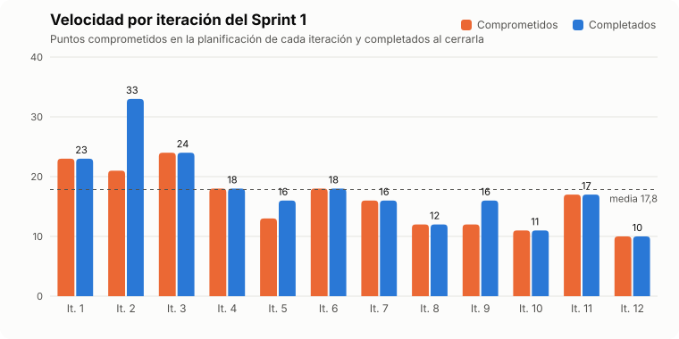
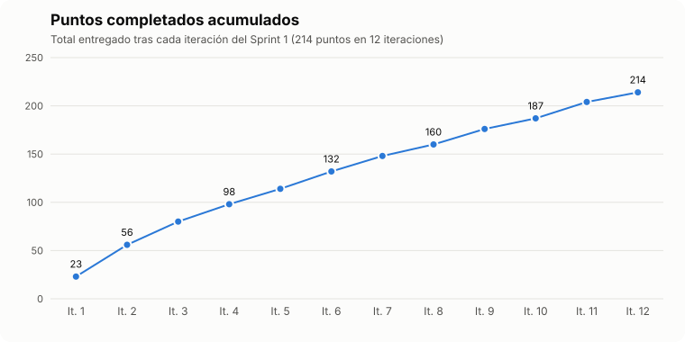

# Métricas del proyecto

Puntos de historia de cada sprint, sacados de las [actas de los sprints](sprints/). Las gráficas se generan con `python3 docs/scrum/graficas/generar.py`.

## Velocidad por sprint

| Sprint | Fechas | Puntos completados | Qué se hizo |
|---|---|---:|---|
| [1](sprints/sprint-1.md) | 19/09 – 3/10 | 214 | 44 historias, en 12 iteraciones el 1 y el 2 de octubre (detalle abajo) |
| [2](sprints/sprint-2.md) | 3/10 – 17/10 | 5 | HU-17, recuperar la contraseña. El resto del sprint fue trabajo sin puntos: 34 fallos corregidos, criterios de aceptación, prioridades, wiki y gestión de riesgos |
| [3](sprints/sprint-3.md) | _por completar_ | | |

- La mayor parte del código se escribió en el Sprint 1 con ayuda de IA, en dos días. Por eso **estas velocidades no sirven para planificar** los siguientes sprints: no dicen cuánto trabajo cabe en un sprint del equipo.
- Para planificar el Sprint 3 hay que usar la estimación en horas de cada historia ([historias de usuario](../requisitos/historias-de-usuario.md#estimación)) y las horas que cada persona puede dedicar.
- En el Sprint 2 los fallos y la documentación no tienen puntos porque no son historias de usuario. Se pueden ver en su acta.

## Iteraciones del Sprint 1

| Iteración | Comprometidos | Completados | Nota |
|---:|---:|---:|---|
| [1](sprints/iteraciones/iteracion-01.md) | 23 | 23 | |
| [2](sprints/iteraciones/iteracion-02.md) | 21 | 33 | 12 puntos añadidos durante la iteración (búsqueda, cancelar, ranking por saldo, más deportes, escudos) |
| [3](sprints/iteraciones/iteracion-03.md) | 24 | 24 | |
| [4](sprints/iteraciones/iteracion-04.md) | 18 | 18 | |
| [5](sprints/iteraciones/iteracion-05.md) | 13 | 16 | 3 puntos añadidos: migraciones con Flyway por el error 500 del ranking |
| [6](sprints/iteraciones/iteracion-06.md) | 18 | 18 | |
| [7](sprints/iteraciones/iteracion-07.md) | 16 | 16 | |
| [8](sprints/iteraciones/iteracion-08.md) | 12 | 12 | |
| [9](sprints/iteraciones/iteracion-09.md) | 12 | 16 | 4 puntos añadidos: interruptor del juego responsable en Gestión y rediseño visual |
| [10](sprints/iteraciones/iteracion-10.md) | 11 | 11 | |
| [11](sprints/iteraciones/iteracion-11.md) | 17 | 17 | |
| [12](sprints/iteraciones/iteracion-12.md) | 10 | 10 | Trazabilidad, servidor con PostgreSQL y tablero |
| **Total** | **195** | **214** | Media de 17,8 puntos por iteración |

- **Comprometidos:** puntos de las historias elegidas al planificar la iteración.
- **Completados:** todo lo terminado al cerrar la iteración, incluido lo que se añadió durante ella. HU-36 (3 puntos), que en la iteración 2 quedó a medias (ranking solo por saldo), está contada en esa iteración.
- Los 214 puntos son más que los 185 de las historias hechas ([estimación](../requisitos/historias-de-usuario.md#estimación)) porque aquí también cuentan trabajos que no son historias: escudos, Flyway, el rediseño o las tareas de la iteración 12.

## Progreso acumulado del Sprint 1 (burnup)

| Tras la iteración | 1 | 2 | 3 | 4 | 5 | 6 | 7 | 8 | 9 | 10 | 11 | 12 |
|---|---:|---:|---:|---:|---:|---:|---:|---:|---:|---:|---:|---:|
| Puntos acumulados | 23 | 56 | 80 | 98 | 114 | 132 | 148 | 160 | 176 | 187 | 204 | 214 |

- El **MVP** quedó completo en la iteración 4, con 98 puntos.
- De la iteración 5 en adelante se hicieron historias *Should* y *Could*: la API, las apuestas a largo plazo, las estadísticas de equipos, los avisos, la gestión de la cuenta, el juego responsable, las plantillas, las ligas privadas y los nuevos tipos de apuesta.

## Burndown de cada sprint

Las iteraciones del Sprint 1 se hicieron en dos días y el Sprint 2 no tuvo historias con puntos salvo HU-17, así que todavía no hay burndown que mostrar.

Para los próximos sprints, el burndown se puede llevar con una tabla en el acta del sprint, rellenada en cada daily:

| Día | Puntos pendientes | Ideal |
|---|---:|---:|
| 1 | 12 | 12 |
| 2 | … | 11 |
| … | … | … |
