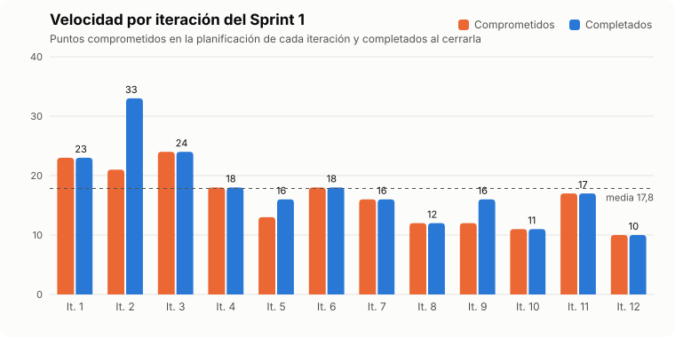
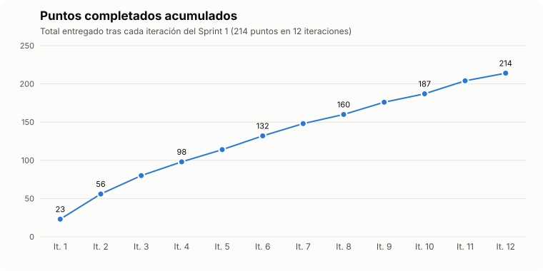
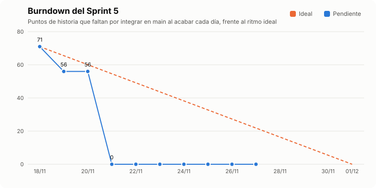

# Métricas del proyecto

Puntos de historia de cada sprint, sacados de las [actas de los sprints](sprints/). Las gráficas se generan con `python3 docs/scrum/graficas/generar.py`.

## Velocidad por sprint

| Sprint | Fechas | Puntos completados | Qué se hizo |
|---|---|---:|---|
| [1](sprints/sprint-1.md) | 19/09 – 3/10 | 214 | 44 historias, en 12 iteraciones el 1 y el 2 de octubre (detalle abajo) |
| [2](sprints/sprint-2.md) | 3/10 – 17/10 | 5 | HU-17, recuperar la contraseña. El resto del sprint fue trabajo sin puntos: 34 fallos corregidos, criterios de aceptación, prioridades, wiki y gestión de riesgos |
| [3](sprints/sprint-3.md) | 21/10 – 3/11 | 2 | HU-54, nombres ofensivos (22/10). El objetivo del sprint fue entender el código que ya había: comentarlo, resumirlo y revisarlo, trabajo sin puntos |
| [4](sprints/sprint-4.md) | 4/11 – 17/11 | 65 | HU-63 a HU-73 (predicciones y cripto, 06/11), HU-76 a HU-80 y HU-84 (16/11): 62 puntos de historias, más los 3 del requisito no funcional RNF-01 (15/11) |
| [5](sprints/sprint-5.md) | 18/11 – 1/12 | 111 (a 27/11) | 26 historias estimadas: HU-55 a HU-62, HU-74, HU-75, HU-81 a HU-83, HU-86 a HU-92, HU-94 a HU-101 y HU-114 a HU-116. Además, 9 integradas sin estimar (HU-102 a HU-107 y HU-111 a HU-113), que no suman. Sprint en curso |

- La mayor parte del código se escribió en el Sprint 1 con ayuda de IA, en dos días. Por eso **estas velocidades no sirven para planificar** los siguientes sprints: no dicen cuánto trabajo cabe en un sprint del equipo.
- Desde el Sprint 3 se planifica con la estimación en horas de cada historia ([historias de usuario](../requisitos/historias-de-usuario.md#estimación)) y las horas que cada persona puede dedicar.
- En el Sprint 2 los fallos y la documentación no tienen puntos porque no son historias de usuario. Se pueden ver en su acta.

## Iteraciones del Sprint 1

| Iteración | Comprometidos | Completados | Nota |
|---:|---:|---:|---|
| [1](sprints/iteraciones/iteracion-01.md) | 23 | 23 | |
| [2](sprints/iteraciones/iteracion-02.md) | 21 | 33 | 12 puntos añadidos durante la iteración (búsqueda, cancelar, ranking por saldo, más deportes, escudos) |
| [3](sprints/iteraciones/iteracion-03.md) | 24 | 24 | |
| [4](sprints/iteraciones/iteracion-04.md) | 18 | 18 | |
| [5](sprints/iteraciones/iteracion-05.md) | 13 | 16 | 3 puntos añadidos: migraciones con Flyway por el error 500 del ranking |
| [6](sprints/iteraciones/iteracion-06.md) | 18 | 18 | |
| [7](sprints/iteraciones/iteracion-07.md) | 16 | 16 | |
| [8](sprints/iteraciones/iteracion-08.md) | 12 | 12 | |
| [9](sprints/iteraciones/iteracion-09.md) | 12 | 16 | 4 puntos añadidos: interruptor del juego responsable en Gestión y rediseño visual |
| [10](sprints/iteraciones/iteracion-10.md) | 11 | 11 | |
| [11](sprints/iteraciones/iteracion-11.md) | 17 | 17 | |
| [12](sprints/iteraciones/iteracion-12.md) | 10 | 10 | Trazabilidad, servidor con PostgreSQL y tablero |
| **Total** | **195** | **214** | Media de 17,8 puntos por iteración |

- **Comprometidos:** puntos de las historias elegidas al planificar la iteración.
- **Completados:** todo lo terminado al cerrar la iteración, incluido lo que se añadió durante ella. HU-36 (3 puntos), que en la iteración 2 quedó a medias (ranking solo por saldo), está contada en esa iteración.
- Los 214 puntos son más que los 189 de las historias hechas ([estimación](../requisitos/historias-de-usuario.md#estimación)) porque aquí también cuentan trabajos que no son historias: escudos, Flyway, el rediseño o las tareas de la iteración 12.

## Progreso acumulado del Sprint 1 (burnup)

| Tras la iteración | 1 | 2 | 3 | 4 | 5 | 6 | 7 | 8 | 9 | 10 | 11 | 12 |
|---|---:|---:|---:|---:|---:|---:|---:|---:|---:|---:|---:|---:|
| Puntos acumulados | 23 | 56 | 80 | 98 | 114 | 132 | 148 | 160 | 176 | 187 | 204 | 214 |

- El **MVP** quedó completo en la iteración 4, con 98 puntos.
- De la iteración 5 en adelante se hicieron historias *Should* y *Could*: la API, las apuestas a largo plazo, las estadísticas de equipos, los avisos, la gestión de la cuenta, el juego responsable, las plantillas, las ligas privadas y los nuevos tipos de apuesta.

## Burndown del Sprint 5

| Día | 18/11 | 19/11 | 20/11 | 21/11 | 22/11 | 23/11 a 27/11 |
|---|---:|---:|---:|---:|---:|---:|
| Puntos de las historias del sprint | 105 | 105 | 105 | 105 | 111 | 111 |
| Integrados en `main` | 34 | 49 | 49 | 105 | 111 | 111 |
| **Pendientes** | **71** | **56** | **56** | **0** | **0** | **0** |

- Los datos salen de la fecha en que se fusionó el pull request de cada historia, no de una tabla rellenada en las dailies, que no se llevó.
- El 17/11, un día antes de empezar, ya se habían integrado 34 puntos (#113, HU-86 a HU-96 y HU-114).
- El 21/11 se integró todo lo que quedaba (56 puntos: casino, anuncios, movimientos, baccarat, cash-out y liga fantasy). Desde entonces el sprint ha sido depuración y documentación, trabajo sin puntos.
- El 22/11 entraron HU-115 y HU-116 (6 puntos), que no estaban planificadas: el alcance sube de 105 a 111.
- No cuentan HU-102 a HU-107 ni HU-111 a HU-113, integradas el 20/11 pero sin estimar.
- **Lectura:** el burndown cae de golpe en vez de seguir la línea ideal porque las historias se integraron en bloques grandes y no una a una. Es la misma señal que el defecto B-03 de la revisión interna (pull requests muy grandes).
- Para el Sprint 6: apuntar en cada daily los puntos pendientes, en el acta del sprint, con esta tabla.
